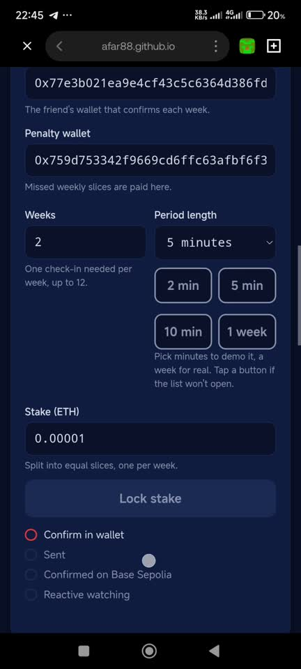
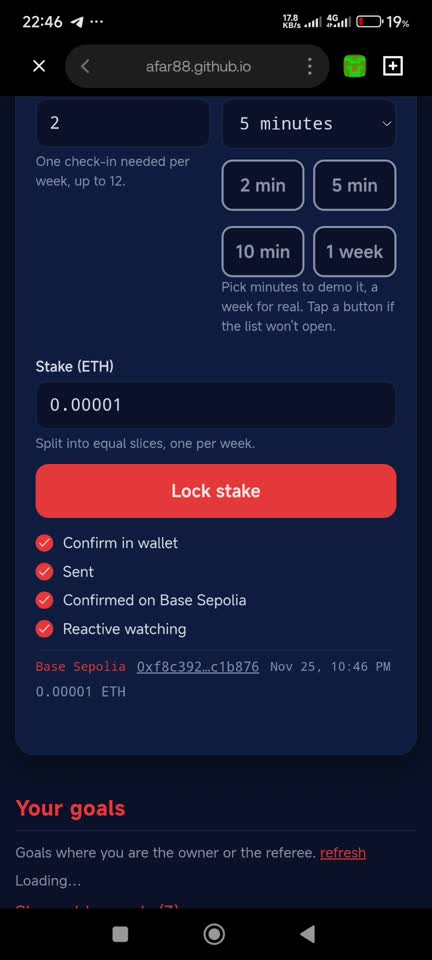
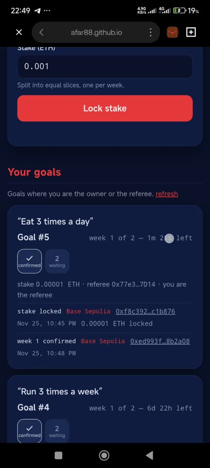
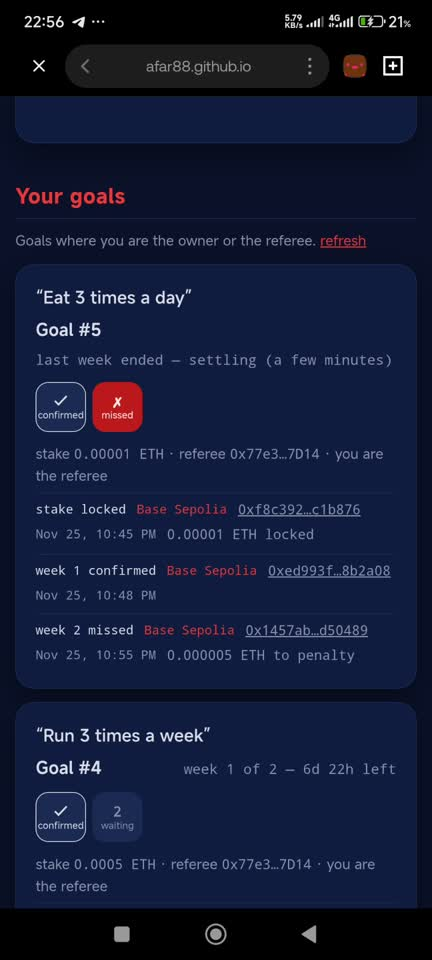
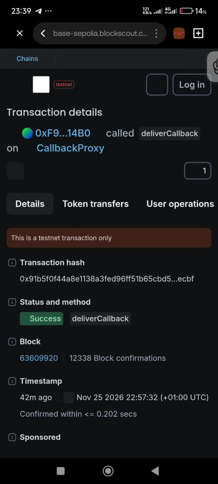

# stake

## For the judges

**What it is:** Stake is a personal commitment vault. You lock a little ETH behind a goal ("Run 3 times a week"), a friend confirms each week, and Reactive automatically forfeits a slice for every missed week and releases the rest at the end. No server, no one pressing buttons.

**Track:** Set It and Forget It.

**Proof — goal #5 ("Eat 3 times a day")**

| Step | Chain | Transaction |
| --- | --- | --- |
| Goal created | Base Sepolia | [View transaction](https://base-sepolia.blockscout.com/tx/0xf8c39220022fbd98d99fefc0ba100fa14433eddf9870e84bd793a1dc8bc1b876) |
| Mirrored (GoalCreated) | Reactive Lasna | [View transaction](https://lasna.reactscan.net/tx/0xbefc74363e0b9717fd88bf96a5bef2c85b6b8b5287d698767e8c41a8c868da9e) |
| Cron forfeit request | Reactive Lasna | [View transaction](https://lasna.reactscan.net/tx/0x8e2634e222d28e6694705453ef5019b67455c19ed3c0eaed47a11f85c06467ae) |
| Forfeit callback | Base Sepolia | [View transaction](https://base-sepolia.blockscout.com/tx/0x1457ab9f254b176647c9b2d789d4d7e62f14e4db11051d58fdf52f06d4d50489) |
| Cron release request | Reactive Lasna | [View transaction](https://lasna.reactscan.net/tx/0x9cc9308204dced9b4270bac9956d7751a5b73b61172775702d19b7326917a701) |
| Release callback | Base Sepolia | [View transaction](https://base-sepolia.blockscout.com/tx/0x91b5f0f44a8e1138a3fed96ff51b65cbd5acec1870f08d58dcbd9354ac84ecbf) |

**Contracts:**
- [StakeVault (Base Sepolia)](https://base-sepolia.blockscout.com/address/0xA7Ba5589A4bB572d6Aa19EECd0F20cf236A1Cb30) — `0xA7Ba5589A4bB572d6Aa19EECd0F20cf236A1Cb30`
- [StakeWatcher (Reactive Lasna)](https://lasna.reactscan.net/address/0x49012E6b5C0441324B0fA7C78e616a4852ddeB0D) — `0x49012E6b5C0441324B0fA7C78e616a4852ddeB0D`

**Measured speed:** Base event mirrored on Lasna in 0 to 2 s; callback lands back on Base in 1 to 2 s; the weekly check runs on Reactive's cron.

**Try it in 2 minutes:** Open [Stake](https://afar88.github.io/stake/) with a Base Sepolia wallet, create a goal with 0.00001 ETH and 5-minute "weeks", skip a confirm, and watch the forfeit and release happen on their own.

**Demo video:** [Watch the demo](https://youtube.com/shorts/l13Ax7nwKA4)

Lock ETH on a weekly goal. A friend confirms each week. Miss a week, lose that week's slice. Finish the goal, get the rest back. No bot, no server — a Reactive Network contract does the chasing.

**Testnet only.** Built for the Reactive Omni Buildathon (DoraHacks, "Set It and Forget It").

## Why I built it

I set weekly goals and drop them by week two. Putting money on the line, with a friend as referee, makes me show up. Nobody has to chase me: the watcher does it on its own.

## How to use it

1. Open https://afar88.github.io/stake/ and connect a wallet on Base Sepolia.
2. Write the goal in a few words, fill in the referee, the penalty wallet, the number of weeks and the stake, and lock it. The goal line is stored on-chain so owner and referee agree on what counts.
3. The referee confirms each week from the same page.
4. Miss a week and that week's slice goes to the penalty wallet. Finish the goal and the rest comes back.

## Screenshots

From the demo run on a phone (goal #5, 5-minute weeks).

| New goal | Stake locked | Week 1 confirmed |
| --- | --- | --- |
|  |  |  |

| Week 2 missed, settled | Callback on Blockscout |
| --- | --- |
|  |  |

## How it works

```
You ── createGoal(referee, penalty, weeks, periodSeconds) ──▶ StakeVault (Base Sepolia)
                                        │  emits GoalCreated
                                        ▼
                              StakeWatcher (Reactive Lasna)
                                        │  mirrors the goal
   referee ── confirm(goalId) ──▶ vault │  emits CheckedIn ──▶ watcher marks week done
                                        │
   cron tick ──────────────────────────▶ watcher
                                        │  week ended, not confirmed ──▶ callback: forfeit()
                                        │  all weeks settled, last ended ──▶ callback: release()
                                        ▼
                          missed slice → penalty wallet · rest → you
```

- **StakeVault** (Base Sepolia) holds the stake, takes referee check-ins, and pays out. It is the source of truth: every callback is re-checked against its own `block.timestamp`. An early or repeated callback emits `Skipped` instead of reverting (failed callbacks are still billed).
- **StakeWatcher** (Reactive Lasna) subscribes to the vault's `GoalCreated`/`CheckedIn`/`Forfeited`/`Released` logs plus a cron heartbeat from the legacy system contract. Each tick it walks the mirrored goals (max 20 per tick), requests `forfeit()` for ended-unconfirmed periods, then `release()` once everything is settled. Sends are idempotent on the vault side, and unconfirmed sends retry after a 4-minute cooldown.
- The timer is switchable: `setCadence(true)` uses Cron100 (~2 min, for demos), `setCadence(false)` uses Cron1000 (~17 min, cheaper for real use). Deployed default is Cron1000.

## Networks

| Contract | Chain | Chain ID | Auth |
| --- | --- | --- | --- |
| StakeVault | Base Sepolia | 84532 | callback proxy `0x476F44b11F5C942c58f4c8E3d0300E5710743585` + rvmId = watcher |
| StakeWatcher | Reactive Lasna | 5318007 | system contract `0x8888...8888` |

## Deployed addresses

| Contract | Address |
| --- | --- |
| StakeWatcher (Lasna, chain 5318007) | `0x49012E6b5C0441324B0fA7C78e616a4852ddeB0D` |
| StakeVault (Base Sepolia, chain 84532) | `0xA7Ba5589A4bB572d6Aa19EECd0F20cf236A1Cb30` |
| Deployer wallet | `0x5874531C1981c1717263fA259Ee5f4099EA8D712` |

## Running cost

The watcher is paused between demos to save testnet fuel. Call `resume()` to run it again. Measured on Cron100 during the demo run: about **0.39 lREACT per hour** of continuous ticking (0.013 per tick); on Cron1000 the same work costs about **0.046 lREACT per hour**. The vault's callback reserve on Base Sepolia is a few milli-ETH and lasts for many goals.

## Demo run (goal #5, 5-minute "weeks", shown in the video)

"Eat 3 times a day", 2 weeks, stake 0.00001 ETH. Week 1 confirmed by the referee, week 2 skipped. The watcher settled it on its own: week 2's share (0.000005 ETH) went to the penalty wallet, the rest came back to the owner.


The main transaction path is listed in [the proof table above](#for-the-judges). The remaining events from the same run are included here for completeness.

| Additional event | Chain | Transaction |
| --- | --- | --- |
| CheckedIn (week 1) | Base Sepolia | [View transaction](https://base-sepolia.blockscout.com/tx/0xed993f1b83877886bb75d69fe88bfd43cf79f2b176216a48b085de40398b2a08) |
| Mirrored (CheckedIn) | Reactive Lasna | [View transaction](https://lasna.reactscan.net/tx/0x3d49016a176279eed962ee884f29caf6f259d02a50a47a2e51d64f031e62c4ab) |
| Mirrored (Forfeited) | Reactive Lasna | [View transaction](https://lasna.reactscan.net/tx/0x8ddd9338a78da28334d953ef6265edc5605abbb6cb15263be4feefe08b98531d) |
| Mirrored (Released) | Reactive Lasna | [View transaction](https://lasna.reactscan.net/tx/0x8493a2113ad5d39424512c0d3dfaf630a5069834d752f2855020ff4ffa7f320f) |

## Live run (10-minute "weeks")

A real 2-week goal — "Run 3 times a week" — week 1 confirmed, week 2 skipped. The watcher did the rest on its own — no bot, no server. Stake 0.0015 ETH; week 2's slice (0.00075) went to the penalty wallet `0xeFfD2FA6190eF0b99213c746a5B8bC22A5000388`, the rest came back to the owner.

| Step | Chain | Tx hash |
| --- | --- | --- |
| GoalCreated | Base Sepolia | `0xb989f5dbf699e67a26867e526a976acee8d9d6e73770d42cfa0fd73518c8a484` |
| CheckedIn (week 1) | Base Sepolia | `0xf9ea5ea806c5cba4ee2d9f4a6a67d3b9031c3323cbcd5f569cf50e0513222eff` |
| Mirror: GoalCreated | Lasna | `0x631bb0e00ff5bdcf65cfd5ae86a27ab33fb59e7ef3796244a74c422540332925` |
| Mirror: CheckedIn | Lasna | `0x3bf5bff8cf3e2b002cc0efdd81f838e7b73e61a34ac10b8784838ab7d7ec8cd5` |
| Cron tick → forfeit requested | Lasna | `0xee58195d29f94671b9f531cfd9a00da2fe284336b5448b524fa4267c412ff9ce` |
| **Forfeited** — 0.00075 ETH → penalty | Base Sepolia | `0xd5d225604308c13cd92e9302d2bfd68eb51d2a04111570c2392e7b6e89a93406` |
| Mirror: Forfeited | Lasna | `0xa6077291065b6b8002bf1383ce77cae6675ecf87865dc770246f4668ef784a15` |
| Cron tick → release requested | Lasna | `0xdc36d17723c5e987db5092f14112e72f2e21f4d7e12472e57fd1dcc5c55d49bf` |
| **Released** — 0.00075 ETH → owner | Base Sepolia | `0x990fc1f23cb1d3bb8403625295de657500124e97d86cb18b3b283b98386eb1d8` |
| Mirror: Released | Lasna | `0x3344ecbb503d716c434361fa8b51fa1e7cb52f684e8cb814d35fb46d27d3bb50` |

## Earlier runs

### Cadence deployment (retired)

The first cadence-enabled deployment (watcher `0x613d425301Df3152C2bDED7c41C1a479c217121b`, vault `0x15ed967149BB327a107c41bC2a9108157cb4fA6D`, both retired) ran the same scenario before goal text existed:

| Step | Chain | Tx hash |
| --- | --- | --- |
| GoalCreated | Base Sepolia | `0x57cca95d7d3f09ed2af3fb4fe6b6f29d381e8265fb3abbd9b2f14dcbd0f2b157` |
| CheckedIn (week 1) | Base Sepolia | `0x55498c2377e9fb64bf9b8e122c3d84b1b8ddab93acf1da4f2757410b5566c613` |
| Mirror: GoalCreated | Lasna | `0xa9ac514c04dd048d5055c085e989ae9f14db0e13510e5aa5b4fcd7b68b4f285d` |
| Mirror: CheckedIn | Lasna | `0x76736f74cc948226b931b0438f6f50f633ad5861396cfd9b5eea2c926e986bb6` |
| Cron tick → forfeit requested | Lasna | `0x08b474047128167b27bd3635fe9dcd684d0839dc4c553f18df2a646231ff2e58` |
| Forfeited — 0.00075 ETH → penalty | Base Sepolia | `0x874245655d60e9f2df60fd21f8a9668d496929970f72c943a12ae8ac121a99c5` |
| Mirror: Forfeited | Lasna | `0x2a55977e6999d5583ef653fe6c2599824ccfa5d2d44ff0b107bbe8ab6e5b1cdb` |
| Cron tick → release requested | Lasna | `0x296928543b41b129ca73de133a737945d5f7543e7fafd82b7f782478f58d9731` |
| Released — 0.00075 ETH → owner | Base Sepolia | `0xed39c6c8d988323104836e3c16aa84cbd3d13dc16022de46b4dad7425eafd96e` |
| Mirror: Released | Lasna | `0x6be2d1439c146e6adf2a9304bc2ed859e6d28b8e2e07a71ae5c880c76ad0c479` |

### First deployment (retired)

The very first full loop ran on the pre-cadence deployment (watcher and vault both at `0x1a4197d80997e285f0f2b928B0d6441444Cb1f8b`, since retired). Same scenario, same outcome — week 1 confirmed, week 2 forfeited, rest released:

| Step | Chain | Tx hash |
| --- | --- | --- |
| GoalCreated | Base Sepolia | `0xaba8c015b7aec873d308dd93abb4b7f06a8939e3dd69c1676ef995cc1f295be5` |
| CheckedIn (week 1) | Base Sepolia | `0xa06d5fa461b16319315ff902e36784491d29ad7b6ed9ae90b872ddd65582b4d3` |
| Mirror: GoalCreated | Lasna | `0xf3068d5f575620f3cb46dc87247a7330eb77e0b1cb6ed0193d79efd10a7ec5dd` |
| Mirror: CheckedIn | Lasna | `0xc817a14a471b4c742770f635e67fc472fffb8c441c0b9e68ab63cf5a085563e2` |
| Cron tick → forfeit requested | Lasna | `0x68c35fc02046c950a7a28aacd8bcdc6ab214a6d50679d9689b442a9016be2914` |
| Forfeited | Base Sepolia | `0xf0c334581d5c5dacfdec55a7ece6d19c7e4765bdd369d15e87fcd9fa0f90ef05` |
| Mirror: Forfeited | Lasna | `0x31a7a34d815d790bb3d525d83b3387a401bb821eaef855d4c4dbf46b4b9a18c4` |
| Cron tick → release requested | Lasna | `0x31a82aeb9e2cd5be536d029aab1b41865ef978fe8218f734e7cbd918da13ff34` |
| Released | Base Sepolia | `0x3bf42e4e9004e5b028d05c24623522ecede2e7ceb8885948b9108c8c5e13b181` |
| Mirror: Released | Lasna | `0x6dd414596d810d4802ed548d23ac7c578366f308a3df61ade598520b6e44a0fd` |

## Develop

```bash
forge build
forge test
```

CI runs `forge build` and `forge test` on every push and pull request.

## Deploy

Needs Foundry and env vars (see `.env.example` — never commit `.env` or keys).

```bash
source .env

# 1. Reactive Lasna — watcher first
forge script script/Deploy.s.sol:DeployWatcher \
  --rpc-url $LASNA_RPC --broadcast --private-key $PRIVATE_KEY
# -> set WATCHER_ADDRESS

# 2. Base Sepolia — vault bound to watcher + callback proxy
forge script script/Deploy.s.sol:DeployVault \
  --rpc-url $BASE_SEPOLIA_RPC --broadcast --private-key $PRIVATE_KEY
# -> set VAULT_ADDRESS

# 3. Lasna — wire watcher to vault
forge script script/Deploy.s.sol:SetVault \
  --rpc-url $LASNA_RPC --broadcast --private-key $PRIVATE_KEY

# 4. Fund both sides (depositTo credits fee reserves)
forge script script/Deploy.s.sol:FundReserves --rpc-url $LASNA_RPC --broadcast --private-key $PRIVATE_KEY
forge script script/Deploy.s.sol:FundReserves --rpc-url $BASE_SEPOLIA_RPC --broadcast --private-key $PRIVATE_KEY

# lREACT for Lasna gas: swap Base Sepolia ETH at the testnet faucet
forge script script/Deploy.s.sol:FaucetLReact --rpc-url $BASE_SEPOLIA_RPC --broadcast --private-key $PRIVATE_KEY

# 5. Open a demo goal (10-minute weeks)
forge script script/Deploy.s.sol:CreateDemoGoal --rpc-url $BASE_SEPOLIA_RPC --broadcast --private-key $PRIVATE_KEY
```

## License

[MIT](LICENSE)
